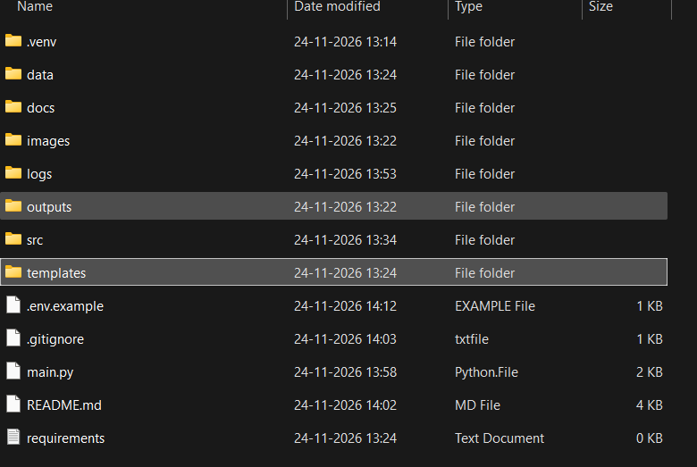
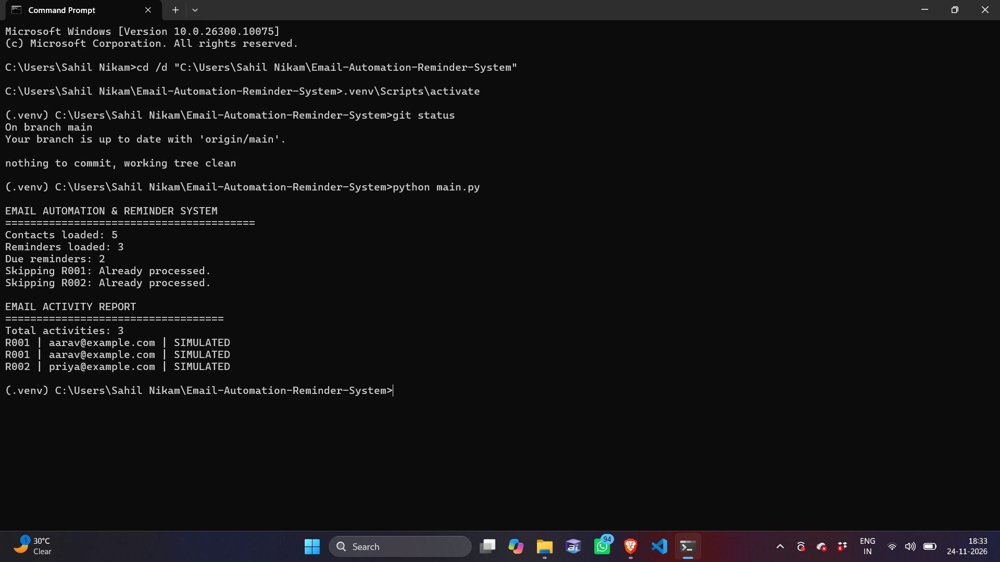
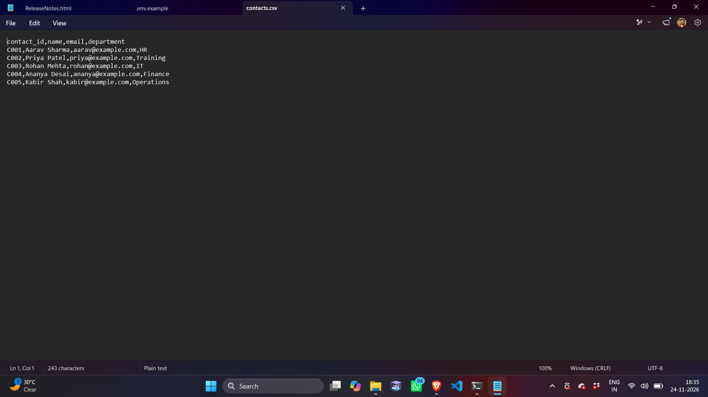
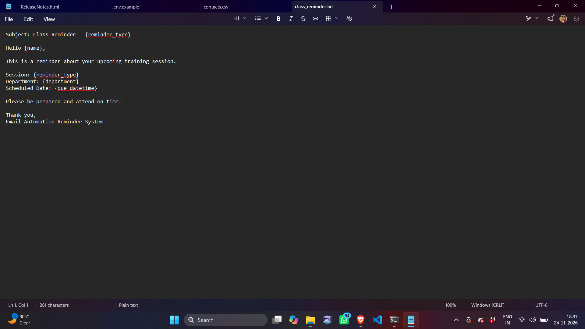

# Email Automation & Reminder System

A Python-based project that automates reminder management and generates personalized email notifications using CSV data, reusable templates, and scheduling logic.

## Features

- Contact management using CSV files
- Reminder data management
- Contact and reminder data validation
- Reusable email templates
- Automatic email personalization
- Due and upcoming reminder detection
- Email sending simulation
- Optional SMTP integration (disabled by default)
- Activity logging and reporting
- Duplicate reminder protection
- Automated unit testing

## Technologies Used

- Python 3
- CSV
- SMTP library
- `unittest`
- Git and GitHub

**Note:** The project uses Python's standard library and does not require external Python packages.

## Project Structure

```text
Email-Automation-Reminder-System/
│
├── data/
│   ├── contacts.csv
│   └── reminders.csv
│
├── docs/
│   └── PROJECT_NOTES.md
│
├── images/
│
├── logs/
│
├── outputs/
│
├── src/
│   ├── __init__.py
│   ├── automation.py
│   ├── config.py
│   ├── data_loader.py
│   ├── mailer.py
│   └── reporting.py
│
├── templates/
│   ├── class_reminder.txt
│   └── task_reminder.txt
│
├── tests/
│   ├── test_automation.py
│   ├── test_data_loader.py
│   ├── test_mailer.py
│   └── test_reporting.py
│
├── main.py
├── requirements.txt
├── .gitignore
└── README.md
```

## Installation

1. Clone the repository:

```bash
git clone https://github.com/SAEE510/email-automation-reminder-system.git
```

2. Open the project directory:

```bash
cd email-automation-reminder-system
```

3. Create a virtual environment:

```bash
python -m venv .venv
```

4. Activate it on Windows:

```cmd
.venv\Scripts\activate
```

5. Install dependencies:

```bash
pip install -r requirements.txt
```

## Usage

Run the project:

```bash
python main.py
```

The program loads contacts and reminders, identifies due reminders, generates personalized email content, simulates sending, and records activity.

## Email Safety

- Email simulation is the default mode.
- No real emails are sent by the default program.
- SMTP integration is disabled by default.
- Credentials are read from environment variables if SMTP is configured.
- Never commit passwords or private contact information.

## Testing

The project includes automated tests covering:

- Contact loading and validation
- Reminder loading and validation
- Email template generation
- Email personalization
- Due and upcoming reminder detection
- Email simulation
- SMTP safety protection
- Activity logging and reporting
- Duplicate reminder protection

Run all tests using:

```bash
python -m unittest discover -s tests -v
```

**Latest test result: 33 tests passed successfully.**

## Project Screenshots

### 1. Project Structure



### 2. Dry Run Output



### 3. Contacts CSV



### 4. Email Template



### 5. GitHub Repository


## Future Improvements

- SQLite database integration
- Web-based dashboard
- Advanced scheduling
- Automated reporting
- Improved error handling

## Project Purpose

This project was developed as a Python learning and portfolio project to demonstrate file handling, modular programming, automation logic, email templates, scheduling, logging, and automated testing.

**Note:** This is a local student prototype, not a deployed enterprise email automation service.